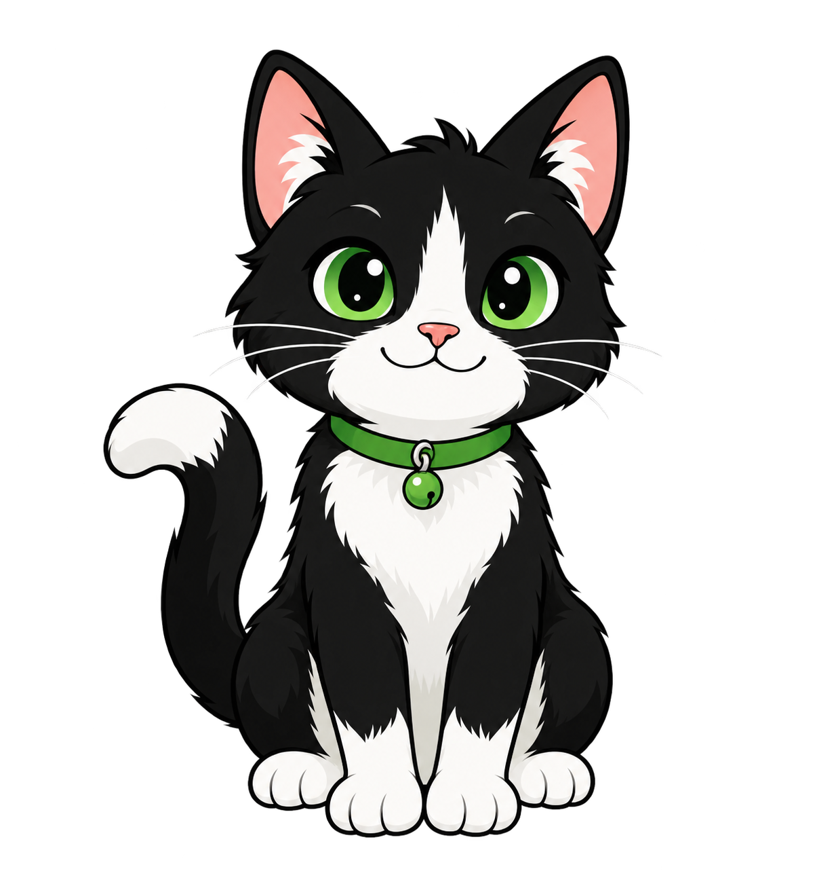
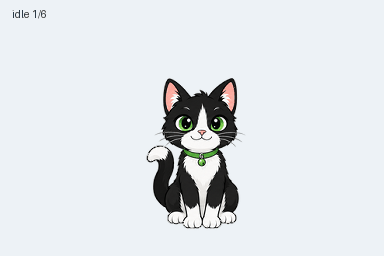

# لینو — گربهٔ لینوکسی

آرشیو کامل فایل‌های موجودِ ساخت پت متحرک **لینو** در ChatGPT Work، ساخته‌شده در ۱۷ اکتبر ۲۰۲۶ با ابزار داخلی imagegen و ابزارهای اعتبارسنجی افزونهٔ Pets.

## مشخصات

- نام فعلی: **لینو**
- نام اولیه هنگام ساخت: **کرنل (Kernel)**؛ نام `kernel` در فایل‌های تاریخی به همین پت اشاره دارد.
- شناسهٔ پایدار: `pet_6ad3c83a2c108191b72d04b73dabefb1`
- وضعیت در زمان ثبت آرشیو: سفارشی و فعال
- شخصیت: گربهٔ لینوکسی کنجکاو و دقیق؛ مدیریت سیستم، Bash، شبکه، امنیت، سرورها، کانتینرها، کرنل و عیب‌یابی
- فایل نهایی: PNG شفاف، نسخهٔ ۲، ابعاد `1536 × 2288`، شبکهٔ ۸ ستون و ۱۱ ردیف، سلول‌های `192 × 208`
- تعداد فریم‌ها: ۷۳ فریم، شامل ۹ حالت متحرک و ۱۶ جهت نگاه
- SHA-256 فایل نهایی: `8ec47312b0a88addf6b5cafa9523f786085540f805721028f76406e177e385ee`

Pets ظاهر و توضیح همراه را تنظیم می‌کند؛ این شخصیت توانایی مستقل، تخصص تضمین‌شده یا قابلیت شنیدن دائمی نام ایجاد نمی‌کند. توافق پاسخ‌دادن به نام «لینو» مربوط به گفتگوی اصلی است و با کپی این پوشه خودکار به گفتگوهای دیگر منتقل نمی‌شود.

## محتویات

| مسیر | محتوا |
| --- | --- |
| [pet.json](pet.json) | نام فعلی، شناسه، توضیح، وضعیت ثبت‌شده و مشخصات |
| [assets/spritesheet.png](assets/spritesheet.png) | فایل دقیق نهایی و اعتبارسنجی‌شده برای Pets |
| [assets/contact.png](assets/contact.png) | تمام حالت‌ها و جهت‌های نگاه |
| [previews/](previews/) | GIF هر حالت، همهٔ حالت‌ها، چرخهٔ نگاه، پرش و نسخهٔ MP4 |
| [creation/decoded/](creation/decoded/) | تصاویر منبع تولیدشده و نمونه‌های کنارگذاشته‌شدهٔ موجود |
| [creation/prompts/](creation/prompts/) | پرامپت‌های پایه، ردیف‌ها و راهنمای اصلاح؛ متن دقیق همهٔ فراخوانی‌های اصلاحی در این فایل‌ها ثبت نشده است |
| [creation/references/](creation/references/) | ظاهر مرجع، راهنماهای چیدمان و جهت‌های اصلی تأییدشده |
| [intermediate-frames.zip](intermediate-frames.zip) | همهٔ فریم‌های استخراج‌شده، هماهنگ‌شده، فریم‌های نهایی و بررسی‌های هر ردیف؛ مسیرهای اصلی در ZIP حفظ شده‌اند |
| [creation/qa/](creation/qa/) | گزارش‌ها، بررسی مستقل جهت‌ها، گزارش اصلاح رنگ و شواهد هماهنگی اندازه |
| [creation/final/](creation/final/) | خروجی نهایی، پیش‌نمایش‌ها و اعتبارسنجی ساختاری؛ فریم‌های مجزا در ZIP هستند |
| [inventory.json](inventory.json) | فهرست فایل‌ها، اندازه و SHA-256 برای بررسی یکپارچگی |

فایل‌های تاریخی درخواست و برنامهٔ تولید حفظ شده‌اند؛ نام اولیه و وضعیت‌های میانی آن‌ها مشخصات فعلی پت نیستند. `pet.json` مشخصات فعلیِ ثبت‌شده و گزارش‌های نهایی شواهد نتیجهٔ ساخت هستند. مسیرهای مطلقِ مخصوص کامپیوتر سازنده در نسخهٔ آرشیوی نسبی شده‌اند؛ مسیرهای شروع‌شده با `creation/` نسبت به همین پوشه‌اند. فایل‌های تصویری نهایی بدون تغییر باقی مانده‌اند.

## پیش‌نمایش

[ویدئوی MP4](previews/all-states.mp4) · [جهت‌های نگاه](previews/look-loop.gif) · [پرش و بازگشت](previews/idle-jump-idle.gif)

## نتیجهٔ بررسی‌ها

- اعتبارسنجی ساختاری نسخهٔ ۲: موفق، بدون خطا
- بررسی کیفیت نهایی: موفق؛ چند تغییر جزئی جهت نگاه با یادداشت بررسی پذیرفته شده‌اند
- بررسی مستقل و بدون برچسب جهت‌ها توسط سه بررسی‌کننده: موفق، بدون ابهام نهایی
- ارتفاع پرش: ۵۲ پیکسل؛ اختلاف نقطهٔ فرود با حالت آرام: ۱ پیکسل
- پیش‌بررسی سرویس Pets: `valid: true` برای همین فایل؛ سپس ساخت، فعال‌سازی و حضور در فهرست پت‌ها تأیید شد

گزارش‌های اصلی: [کیفیت](creation/qa/pet-quality.json)، [ساختار](creation/final/validation-extended.json)، [جهت‌ها](creation/qa/blind-validation.json).

## استفاده یا بازیابی

برای بازیابی ساختار کامل فایل‌های میانی، `intermediate-frames.zip` را در همین پوشه استخراج کنید. ۲۴۸ فایل بدون تغییر بایت‌ها در این ZIP حفظ و پس از فشرده‌سازی با نسخهٔ اصلی مقایسه شده‌اند.

برای استفاده در همین حساب، پت را با شناسهٔ پایدار بالا انتخاب کنید. برای ایجاد نسخهٔ جدید از فایل، باید `assets/spritesheet.png` در گردش کار رسمی Pets اعتبارسنجی، بارگذاری و سپس ثبت شود؛ کپی فایل به ریپو به‌تنهایی پت جدیدی نصب نمی‌کند. شناسه به رکورد حساب اصلی اشاره دارد و مجوز دسترسی به آن را منتقل نمی‌کند.

فایل‌های Python داخل `creation/` اسکریپت‌های کمکی این اجرا هستند. وابستگی‌های آن‌ها شامل Python، Pillow، NumPy و برای MP4 بستهٔ `imageio-ffmpeg` است. اسکریپت‌های اصلی افزونهٔ Pets و محیط اجرایی در این آرشیو توزیع نشده‌اند؛ بنابراین پوشه یک آرشیو کامل از مصنوعات موجود است، نه نصب مستقل افزونه. برای بازتولید، مسیرها و محیط اجرایی را تنظیم کنید و پس از هر تغییر تصویر، تمام بررسی‌های نهایی را دوباره اجرا کنید.

توکن، نشست بارگذاری یا لینک موقت دانلود در آرشیو ذخیره نشده است. ابزار Library هنگام ساخت در دسترس نبود؛ این ریپو آرشیو فایل‌های محلی موجود است.
